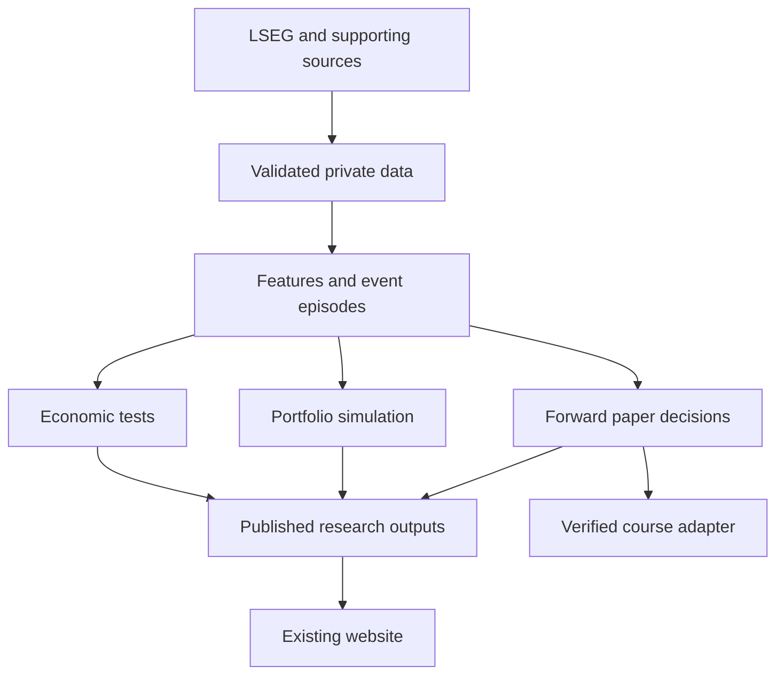

# FINTECH 535 — Conditional Volatility Premium

**Coding-agent implementation specification · Version 1.0 · November 21, 2026**

## Scope for this assignment (PO, TD-03)

The thesis assignment is due **Tue Nov 24 2026, 11:59 pm ET** (TD-02). It asks for the seven items R1–R7 in §2: the thesis, its horizons, a tracker chart that stays current day to day, two or three wrong-if conditions, a rough alpha/cost note, a macro paragraph, and a live page. This spec describes the whole research system. This assignment builds only the thesis, its daily tracker and their page. The rest stays here, unchanged, for the backtesting assignment and the final project. Where a PO answer amends the spec for this assignment, the cited `TD-nn` entry in [DECISIONS](DECISIONS.md) governs. The live wheel keeps running and is untouched.

| Section | This assignment |
| --- | --- |
| §0 Mandate | The economic test's tracker and R1–R7. The trading test is deferred |
| §1 Thesis and narrative | In, as written |
| §2 Traceability | R1–R7, with R4 and R5 as amended by TD-08 and TD-07 |
| §3 Architecture | Adapted to the repo: Python under `pmcc/`, the site's existing React and ECharts pages. No private store: no ledger or vendor quote tables are kept. The nightly run re-derives the tracker from LSEG (and FRED) and commits only derived files (TD-09) |
| §4 Data | §4.1: a probe (T1-01), its results recorded in DECISIONS instead of `research/data_inventory.md`. §4.2: S&P 500 index and VIX closes (TD-04), the high-yield OAS (TD-05); PM options only as R5's cost sample (TD-07); rates and Treasury yields out. §4.3: the SPXW profile checked in the probe, for R5's cost only. §4.4: in, for the tracker's series |
| §5 Features and tracker | In, as written |
| §6 Options implementation, §7 Execution and ledger | Out (backtesting) |
| §8 Historical evaluation | Out, except the stable/unstable cohorts' matured variance outcomes (analysis D) that K1 and R5 read. R5 is a rough, evidence-informed estimate (TD-07) |
| §9 Wrong-if conditions | K1 calculated; K2 and K3 shown as "Not yet evaluated — requires strategy backtesting" (TD-08). Status fields: `run_status`, `data_status`, the tracker's `signal_status` values (`NO_SHOCK`, `SEARCHING`, `NO_CANDIDATE`, `FILTERED_OUT`, `ELIGIBLE`), `thesis_status` and `evidence_status`; the trading values and `position_status` are out |
| §10 Website | Components 1–4 and 7–10 (TD-10), with the raw credit spread charted (TD-06); 5 (trading comparison) and 6 (forward record) are out |
| §11 Data model | Out, except the provenance fields on the public JSON (§10) |
| §12 Nightly pipeline | The `thesis` workflow (TD-09); no Sanji integration |
| §13 Configuration | The keys the tracker and K1 read |
| §14 Tests | 1–4, 12 (K1's sample gate), 13, and 14 as the tracker's end-to-end fixture with a real-data smoke check; 5–11 are out |
| §15 Sequence | Steps 1 and 2, and step 5's automation; 3 and 4 are out |

## 0. Implementation mandate

Build a reproducible research and paper-trading system that tests this thesis, updates its supporting evidence every trading day, and presents all seven assignment deliverables on the student's existing website. Read this entire specification before implementing. Inspect the target repository, its AGENTS.md, existing data access, deployment, nightly workflow, and Sanji order contract first. Extend working components where possible.

This document specifies a hypothesis and provisional research rules. It does not claim that the strategy has alpha. Implement the rules faithfully; do not optimize them until the project looks profitable. A valid negative finding is a successful research outcome.

The implementation has two distinct tests:

1. **Economic test:** Does the proposed state predict an unusually large difference between option-implied variance and subsequent realized variance?
2. **Trading test:** Can a specified options position capture useful returns after realistic execution costs and losses during adverse events?

A positive result in one does not establish the other. Do not treat a VIX-minus-realized-volatility chart, collected option premium, or a high win rate as proof of tradable alpha.

### Deliverable scope

- A nightly data-to-research-to-website pipeline, historical evaluation, forward paper record, documented configuration, and meaningful tests.
- A single underlying and one initial options implementation. Instrument selection is explained below; a strategy tournament is out of scope.
- No brokerage connection or real-money orders. Preserve existing course functionality. Integrate with Sanji only through the repository's verified course contract.
- No LLM in signal generation, contract selection, pricing, or execution decisions.
- Do not build accounts, a database server, a custom CMS, or a new frontend framework when the repository already provides an adequate solution.
- If credentials are unavailable, implement and test adapters with clearly separated fixtures, finish the website and analytical code, and report the precise remaining data dependency. Do not present fixture results as market evidence.

## 1. Assignment-ready thesis and narrative

### R1 — One-sentence thesis

> Following equity-volatility spikes, options overprice subsequent market fluctuations when corporate credit conditions remain stable and realized volatility begins to normalize, creating opportunities to sell protection selectively after costs.

### Economic explanation

The proposed mechanism is that demand for protection can remain elevated after an initial equity-market shock. If credit conditions remain stable and actual price fluctuations begin to diminish, the insurance price may decline more slowly than the underlying risk. Stable credit is proposed as evidence that the shock is less likely to become a persistent financing or solvency problem.

This is a testable interpretation, not an established causal conclusion. Credit spreads can lag, volatility can rise again, and option sellers ordinarily receive compensation for bearing adverse tail outcomes. The system must test whether the credit condition adds information beyond an ordinary volatility forecast and whether the resulting trades offer useful net compensation for their exposure.

### R2 — Time horizons

- **Thesis useful life:** Working estimate of 12–24 months as a recurring opportunity, reassessed quarterly. This is a planning estimate, not an empirical forecast of persistence.
- **Forecast/tracker horizon:** 30 calendar days, using the daily-close realized-variance convention in §5.
- **Contract horizon:** Approximately 30 calendar days to expiration at the intended execution date.
- **Expected trade lifetime:** Approximately 5–10 trading sessions; a provisional estimate. Report the measured mean and median once trades exist.
- **Maximum planned holding period:** Ten trading sessions after entry, with earlier exits under §7. Report delays caused by unavailable quotes separately.

### R6 — Macro-environment paragraph for the website

> This thesis is most plausible when a volatility spike reflects a temporary repricing of equity risk while corporate financing conditions remain comparatively stable. Persistent inflation surprises, unexpected changes in Federal Reserve policy, deteriorating credit conditions, or renewed equity selling could instead produce sustained volatility. A technology-sector selloff could remain concentrated or spread into broader financial stress; the strategy therefore evaluates broad equity volatility alongside corporate credit rather than assuming every selloff will reverse. Lower implied volatility alone does not guarantee a profitable trade, because the underlying can move enough to overwhelm the benefit from cheaper options. These relationships are hypotheses evaluated by the tracker and historical tests, not assumptions that a particular macro regime is currently present.

Display this paragraph with a separate, dated current-state summary generated from measured inputs. Do not fabricate explanations for daily moves or claim a news event caused them without sourced evidence.

## 2. Assignment traceability

| ID | Required deliverable | Implementation | Acceptance evidence |
|---|---|---|---|
| R1 | One-sentence thesis | Exact thesis above, prominently displayed | Visible text on published page |
| R2 | Time-horizon estimate | Useful life, forecast horizon, expected and measured holding periods | Labeled horizon card and methodology |
| R3 | Tracker definition and chart | Formulas in §5; daily charts in §10 | Current real-data chart, data-through date, source provenance |
| R4 | Two or three wrong-if conditions | Three numerical tests in §9 | PASS / FAIL / INSUFFICIENT DATA with sample sizes |
| R5 | Rough alpha/cost note | Empirical net-return and cost table in §8 | Real measured estimate, uncertainty, denominator, and assumptions |
| R6 | Macro-environment paragraph | Paragraph in §1 plus dated indicator summary | Visible explanation tied to trade risks |
| R7 | Live webpage link | Existing site/GitHub Pages deployment | Working URL, automated refresh, honest data status |

A coded mockup alone does not complete R3 or R5. If measured net returns are zero or negative, publish that result. If data remain unavailable, label the assignment implementation incomplete and identify the missing requirement; do not fill the gap with invented numbers.

## 3. Architecture and delivery boundaries

Use the repository's existing language and frontend where suitable. Recommended research implementation: Python with pandas/numpy/scipy, typed schemas, Parquet, and SQLite for durable state. Use the current supported LSEG Python library available to the course. Pin the actual dependency versions used. A static website reading generated JSON is sufficient.



Suggested modules, adapted to existing repository conventions:

```text
config/thesis_v1.yaml
src/thesis/data/{lseg,credit,calendar,validation}.py
src/thesis/{features,episodes,signals,pricing,contracts}.py
src/thesis/{execution,ledger,backtest,evaluation,kill_rules}.py
src/thesis/{publish,cli,course_adapter}.py
tests/{fixtures,unit,integration}/
research/{data_inventory,methodology,results,limitations}.md
public/thesis/{status,tracker,events,performance,criteria}.json
.github/workflows/thesis-nightly.yml
```

Raw market data, credentials, contract quote history, and the trading ledger belong in private durable storage. GitHub Actions cache is not the only copy of the ledger. Reuse an existing private storage mechanism; if none exists, specify and implement a small private artifact/object-store or persisted self-hosted-runner route. Public outputs must be an explicit allowlist.

## 4. Data and access discovery — first implementation milestone

### 4.1 Capability inventory

Produce `research/data_inventory.md` with the following, supported by actual sample requests:

- Authentication/session type and whether it works without an interactive desktop.
- Verified instrument identifiers, vendor fields, units, timestamps, quote convention, and date coverage.
- Historical expired-contract discovery, not just today's option chain.
- Presence of bid and ask, expiration timestamps, exercise style, settlement method, multiplier, and contract adjustments.
- Availability of option IV/Greeks; whether these can instead be calculated from observed prices.
- Credit-series coverage, publication lag, vintage/revision handling, and permitted website outputs.
- Rate limits, missing-data rates, and estimated acquisition volume for the selected period.
- Existing Sanji instrument support, order format, execution timing, and multi-leg behavior.

LSEG desktop and platform access are different. A Workspace desktop session generally requires the application on the same machine. A GitHub-hosted runner cannot assume access to the student's desktop. Use the existing course-server feed if it supplies the required history and daily quotes; otherwise use an entitled platform session or a managed runner with the necessary desktop environment. Document the chosen route. Do not embed personal credentials or automate an unsupported login flow. [S3]

### 4.2 Required data

| Data | Primary route | Alternative / constraint | Purpose |
|---|---|---|---|
| S&P 500 price-index daily closes | LSEG | Compatible documented source with matching index definition | Returns, features, realized outcomes |
| VIX daily observations | LSEG | Official Cboe history or other authorized source | Shock definition and 30-day implied-variance proxy |
| PM-settled European S&P 500 index options | LSEG historical and current quotes | Same contracts from the course feed if provided | Actual strategy pricing and P&L |
| US high-yield option-adjusted spread | Entitled LSEG/ICE history, exact definition verified | FRED BAMLH0A0HYM2 for available dates only | Credit stability |
| Risk-free rate and dividend/forward inputs | LSEG | Documented Treasury-rate proxy and forward inferred from put-call parity | IV/Greeks and cash benchmark |
| Exchange sessions and holidays | Maintained exchange calendar plus contract metadata | Official exchange calendar | Trading dates, expiration, DST |
| Optional 2-year/10-year Treasury yields | LSEG or FRED | Context only in v1 | Macro dashboard |

**Known coverage issue:** FRED's BAMLH0A0HYM2 notes state that, starting April 2026, only three years of observations are supplied. Do not assume that FRED can provide the full historical credit series for a 2015–present backtest. Obtain entitled history through the course/LSEG, use the true common data window, or label long-history credit tests unavailable. Do not substitute a different credit metric or splice series silently. [S4]

Do not assume free API access grants redistribution rights. Keep vendor quote tables private. The ICE/FRED series has explicit publishing restrictions; verify permitted displays. Publish permitted original analytical outputs and methodology, not a downloadable mirror of restricted raw values. Derived status alone does not guarantee exemption. The website must retain a useful real-data tracker even when a raw credit chart cannot be displayed.

### 4.3 Instrument profile

Primary profile: **SPX PM-settled European cash-settled options**, identified by verified contract metadata, typically the SPXW family. Use a $100 multiplier only after metadata confirms it. European cash settlement avoids early assignment and share-delivery modeling in the first implementation. Cboe distinguishes AM and PM series; the ticker root alone is insufficient. [S5]

Do not mix AM-settled SPX, PM-settled SPXW, SPY, or XSP within one result series. The older LSEG tutorial specifically illustrates certain AM-settled contracts, so its discovery code must not be copied unchanged into this PM-only profile. [S2]

If PM-option coverage is unavailable, complete the economic tracker and identify the trading-data blocker. An SPY, XSP, or AM-settled profile is a documented separate implementation, with its own exercise/settlement handling and dataset version. Do not silently substitute American options into European pricing or an index-settlement simulator.

### 4.4 Time and availability contract

Every raw observation has:

```text
source, series_or_instrument_id, observation_ts, session_date,
available_at, retrieved_at, value, unit, vintage_id,
availability_method, quality_flags, source_payload_hash
```

- Persist UTC timestamps; use `America/New_York` for sessions and the website.
- Signals may use only observations with `available_at <= decision_ts`.
- Observation date is not publication time. As-of join credit data; never join today's market close to a credit observation that was published tomorrow.
- If historical availability is unavailable, use a disclosed conservative assumption of observation date plus **two US business days at 20:30 New York time**. Test one- and three-business-day lags as sensitivities; do not select the best lag by test performance.
- Historical data retrieved now are not automatically point-in-time. Prefer available vintages; otherwise disclose revision risk. A lag does not cure revisions.
- In the forward record, retain first-seen values and arrival times. Later corrections create a new research dataset version and never rewrite an executed paper decision.
- Underlying, VIX, and option inputs must be current for the decision session. Credit may be up to three US business days old; older or absent data block new entries.
- Do not forward-fill option quotes or market returns across missing trading sessions. Weekend dates are not missing trading sessions.

## 5. Features and economic tracker

All thresholds below are **provisional, predeclared v1 assumptions**, not optimized parameters or measured findings. Keep them in configuration and display the relevant values on the methodology page.

### 5.1 Returns and forecast

Use price-index close-to-close log returns, `r_t = ln(S_t / S_(t-1))`. Do not use a dividend-adjusted ETF series as though it were the index price. Require 252 valid historical sessions for signal warmup.

For the initial volatility forecast, use EWMA:

```text
v_t = 0.94 * v_(t-1) + 0.06 * r_t^2
```

Initialize with the mean squared returns of the first 60 valid sessions. No estimated mean-return term. All initialization uses past data only. Define recent realized measures as `RV_n(t) = sqrt(252 * mean(r^2 over the last n sessions))` for n=5 and n=20. Store volatility internally as a decimal, not percentage points.

### 5.2 Matched-horizon tracker

At session t, define a 30-calendar-day observation interval beginning at that session's close. Let `N_t` be the number of future exchange closing observations within that interval, determined solely from the exchange calendar.

```text
VIX_decimal_t = VIX_points_t / 100
implied_total_variance_t = VIX_decimal_t^2 * (30 / 365)
forecast_total_variance_t = N_t * v_t
forecast_vol_30_t = sqrt(forecast_total_variance_t * 365 / 30)
forecast_gap_vol_t = VIX_decimal_t - forecast_vol_30_t
forecast_gap_variance_t = implied_total_variance_t - forecast_total_variance_t
```

After the interval matures:

```text
realized_total_variance_t = sum(r_j^2 for future closing observations in the interval)
realized_vol_30_t = sqrt(realized_total_variance_t * 365 / 30)
realized_variance_premium_t = implied_total_variance_t - realized_total_variance_t
```

These are daily-close sampled outcomes, with no separate return observation on non-trading days. Include close-to-close gaps in the next observed return. Disclose this sampling convention; it is not an exact replication of continuously observed or option-strip variance. Do not call VIX an ATM option quote, an executable asset, a physical expected return, or the IV of the chosen spread. Cboe defines VIX through option prices and a constant 30-day variance calculation. [S6]

Forecast and realized lines must share the same calendar convention. Future realized outcomes belong only in evaluation tables. They are null until mature and never enter the historical or live signal.

### 5.3 Shock episodes

At t, a new shock occurs if both are true:

1. VIX_t is at or above the 80th percentile of the **preceding** 252 sessions, excluding t.
2. VIX_t / VIX_(t-5) >= 1.25.

The first qualifying shock opens a fixed episode with candidate-search dates s+1 through s+10 trading sessions. Ignore additional shock triggers during this search interval; do not reset its end date after observing the market path. A new episode may start after the search interval ends. Label potentially overlapping outcome windows for inference.

### 5.4 One candidate date per episode

The candidate date is the **first** search-window session for which:

- `RV_5(t) < RV_20(t)`;
- `RV_5(t) <= RV_5(t-3)`; and
- `forecast_gap_vol_t >= 0.03` (three annualized volatility percentage points).

Determine this date **without using the credit condition**. Record one candidate or `NO_CANDIDATE` for every episode. This avoids giving the credit-filtered strategy a later, retrospectively convenient entry date.

Missing data produce a recorded data-quality outcome, not a negative signal. If missing mandatory feature observations prevent identifying the first qualifying date in the search interval, mark the episode `INCOMPLETE_CANDIDATE_SEARCH`; do not pretend a later observable date is necessarily the first. Once a candidate date is assigned, do not move it because options are unavailable or the trade would lose.

### 5.5 Credit condition

Normalize credit spreads to basis points. For FRED percent units, 3.52 means 352 bps, not 3.52 bps or 35,200 bps.

Using only the latest credit observations available at the candidate decision time, define stable credit as all three:

- Latest OAS <= 450 bps.
- Change from the observation five valid source sessions earlier <= +15 bps.
- Change from the observation twenty valid source sessions earlier <= +40 bps.

Negative changes satisfy the change limits. Retrieve the comparator observations from the same source/definition. The selected candidate is `ELIGIBLE` only if stable credit is true and all mandatory data are valid. An unstable-credit candidate is `FILTERED_OUT` for this episode, not reconsidered later.

The macro dashboard can explain other series, but do not add news, FOMC exclusions, yield-curve conditions, trend filters, or additional predictors to v1 without a new model version.

## 6. Options implementation

### 6.1 Why this initial position

Use a **credit iron condor** as the first controlled implementation: sell an out-of-the-money put spread and an out-of-the-money call spread with one expiration. The thesis is initially non-directional and concerns expensive protection, so the position offers a defined expiration loss and generally negative vega/gamma near its center.

This choice is an implementation assumption, not an extra thesis. A calendar, straddle, strangle, covered call, butterfly, or vertical becomes a separate experiment only when evidence supports its different exposure. Do not compare many structures and select the highest-return backtest.

### 6.2 Contract selection at the signal date

Use the candidate session's validated option snapshot. The intended execution session is the next exchange session.

1. Consider only the verified PM, European, cash-settled profile.
2. Choose an expiration 28–35 calendar days from the intended execution session, closest to 30 days; ties choose the earlier expiration.
3. Choose an OTM short put with delta closest to -0.20 and an OTM short call closest to +0.20. Each must be within 0.05 of its target. Use deterministic ties: smaller delta error, then narrower spread, then contract ID.
4. Define target wing width as 0.005 times the signal-date index level. Choose the smallest common available put/call width at least this large and no more than 1.5 times this large. Both wings must exist, be further OTM, and pass quality checks. If not, skip the trade.
5. Require `K_long_put < K_short_put < S_t < K_short_call < K_long_call` and equal put/call wing widths W.
6. Require observed opening natural credit C to satisfy `0 < C < W`.
7. For a one-unit spread, require absolute summed option delta <= 0.10, summed vega < 0, and summed gamma < 0 at selection. These are initial checks, not permanent properties.
8. Store all four immutable contract IDs, prices, Greeks, and the reason for every rejection. Never construct a fictitious contract by rounding a target strike.

If vendor Greeks are unavailable, solve IV from observed midquotes and calculate European Greeks with a documented rate/forward model. Prefer a same-maturity forward inferred from valid near-ATM put-call pairs. Label calculated versus vendor analytics and the units: vega per one volatility percentage point, theta per calendar day, and delta per underlying unit. Reject impossible prices or failed solvers. Model values may support Greeks and diagnostics; **they may not replace missing historical execution quotes**.

### 6.3 Quote requirements

- Quotes must refer to the correct session and compatible snapshot convention. Prefer synchronized end-of-day snapshots; record any source-level timestamp assumptions.
- Require finite bid >= 0, ask > 0, ask >= bid, and positive midpoint. A zero bid on a long wing is allowed only when ask and timestamp are valid; do not manufacture a sale price for that wing on exit.
- Reject a leg when ask-bid exceeds `max(1.0 index point, 0.20 * midpoint)`. This is provisional and must be reported with rejection counts.
- If actual timestamps exist, require legs within five minutes of the configured snapshot boundary and each other. A source providing date-only official EOD records must be separately flagged, with its documented convention; do not claim intraday synchronization.
- Never use an old last trade as a substitute for a current bid/ask. Open interest is descriptive unless its availability timestamp is known; do not use today's published OI as yesterday's information.
- Missing quote rejections must remain in the research audit, especially around stress events.

## 7. Execution, ledger, and position management

### 7.1 Decision and execution clock

- Generate the signal after session t, no earlier than 20:30 New York time and only when mandatory inputs have arrived.
- Historical baseline fills at the documented EOD snapshot of **t+1**, using the four contracts fixed at t. This is a next-session EOD approximation, not a same-close or intraday fill claim.
- Submit a one-session-valid combo intent with minimum credit equal to 80% of the signal-date natural credit. If the next-session natural credit is below the limit, the combo is unfilled and expires. Do not infer intraday limit touches from daily bars.
- Fill the entire combo or none in the research simulator. Do not simulate naked partial legs.
- Do not recompute the signal from t+1 closing indicators and then claim a t+1 closing fill. Contract/limit changes require a new documented decision.
- Recheck contract identity and executable quote quality at the fill snapshot. Quantity may be reduced to keep within the predeclared risk budget; never increased based on execution-day outcomes.
- A missing/unfilled entry is not retried on a later session within the same episode.

### 7.2 Costs and prices

Base execution: buy at ask, sell at bid, on entry and exit. Opening credit is short-leg bids minus long-leg asks. Closing debit is short-leg asks minus long-leg bids.

- Base all-in commission/fee assumption: **$2 per contract per transaction**, configurable and explicitly provisional.
- Four contracts per one-unit combo mean eight contract transactions for an ordinary entry and exit: $16 in assumed fees.
- Base half-spread costs are already embedded in natural fills; do not subtract the same spread twice.
- Report midprice/no-fee diagnostics separately from the conservative base case.
- Stress case: base fills plus another half of each quoted bid/ask spread in the adverse direction and twice the base fees. Do not permit negative execution prices.
- Treat modeled package fills as hypothetical. Actual multi-leg execution may differ.

### 7.3 Sizing and accounting

- Paper initial equity: **$1,000,000**; a research denominator, not an estimated necessary investment.
- Maximum modeled expiration loss plus estimated round-trip fees per new position: **0.5% of current account NAV**.
- One open position per portfolio; no pyramiding, rolling, or delta hedging in v1.
- For a one-unit equal-width condor, expiration max loss before fees is `(W - C) * multiplier`. Contracts are integer units; zero units means skip.
- Reserve the full wing-width cash liability `W * multiplier * quantity` from account cash after receiving the credit. Distinguish this cash reserve from economic max loss; do not make the received credit available twice.
- Cash flows, commissions, signed positions, marked liabilities/assets, reserves, and NAV must reconcile.
- Mark primary NAV at conservative liquidation prices, with mid-NAV as a separate diagnostic. Never treat received premium as earned profit on entry.
- Accrue the documented cash rate only on unencumbered cash; compare with an all-cash benchmark. If rates are missing, use zero for both consistently and disclose the limitation.
- The theoretical expiration loss bound is not a license to clamp observed interim liquidation costs; wider spreads can make early liquidation more expensive. Retain and explain such cases.

### 7.4 Exit rules

Evaluate at each valid session close after entry, then execute a queued exit at the next session's valid EOD snapshot. Do not fill at the price that triggered the exit.

Queue an exit when any of these first occurs:

1. Closing debit <= 50% of opening credit (profit target before fees).
2. Closing debit >= 200% of opening credit (loss trigger; not a guaranteed stop price).
3. The scheduled next execution would occur ten or more trading sessions after entry. With a one-session exit delay, queue this time exit after nine complete sessions so the planned fill is at entry session + 10.
4. Ten or fewer calendar days would remain to expiration at the scheduled next execution session.
5. The latest available credit state no longer satisfies the three stability conditions.
6. A separate account safety halt in §9 is triggered.

Keep the first trigger and any concurrent triggers. A missing quote cannot be interpreted as a target or stop fill. A queued exit remains queued until valid quotes arrive. At actual expiration, settle European options using the official settlement value and verified multiplier; if that value is missing, status is `UNRESOLVED`, not assumed closed.

### 7.5 Data outages

Data failure blocks new entries, never cancels exit intent, and never deletes an open position. Preserve last good marks with a stale flag; do not report them as current valuations. Once quotes return, execute pending exits according to the declared model. Report the worst-case expiration liability as a risk bound during unresolved periods. Publish outage duration and coverage. Do not quietly drop affected trades from performance statistics. If an evaluation period contains an unresolved position, publish provisional values and liability bounds; do not label that period's positive net return or R5 trading estimate complete until the position is resolved. Compare quote-coverage rates across credit cohorts so selective missingness cannot masquerade as a filter advantage.

## 8. Historical evaluation and the alpha/cost note

### 8.1 History and research splits

Request 2015-01-01 onward, with at least 252 prior warmup sessions where available. Actual common coverage governs the study. Do not claim the test includes 2020 or another stress period unless all relevant inputs cover it.

If full coverage exists, use 2015–2019 for development, 2020–2022 for validation, and 2023 onward as a reserved historical evaluation period. Freeze config and code before opening that evaluation result. This is retrospective validation; only post-deployment observations form the forward record.

If coverage is shorter, use a predetermined chronological 60%/20%/20% split by sessions, recorded before computing strategy results. Purge observations at each boundary when their 30-day outcome or trade lifetime crosses the boundary. Require sufficient events, not merely a large count of daily rows. A sample with less than five years or few independent episodes may still produce an assignment tracker, but must be labeled exploratory.

Preserve an experiment log containing every tested configuration. Never repeatedly tune against the reserved period and keep calling it untouched. Any change to signal logic starts a new model version.

### 8.2 Required comparisons

| Policy / analysis | Definition | Question answered |
|---|---|---|
| A: Full thesis portfolio | Candidate rules plus stable-credit filter, one position maximum | Is the complete proposed system useful? |
| B: Credit-filter removal | Same candidate dates, contract rules, costs, and risk budget; accept both stable and unstable credit | Does credit selection add value? |
| C: Calendar baseline | Signal each Monday when flat; same contract construction, risk budget, fees, and exits except credit-driven exit | Is the result more than routinely selling options? |
| D: Mechanism cohorts | All episode candidates, stable versus unstable credit; subsequent 30-day variance outcomes | Does the underlying economic prediction hold? |
| E: Standardized event trades | One shadow trade per candidate, regardless of other open shadow trades | Are portfolio capacity constraints hiding the event-level result? |
| F: Benchmarks | Cash; broad equity total return as contextual benchmark | How do total returns and exposure differ? |

For B and E, omit the credit-driven exit as well as the credit entry filter when testing the entire credit overlay. Also report an **entry-filter-only ablation** with identical non-credit exits for both selected and unselected event trades, so the effect of selection is not confused with a different exit rule.

Shadow event trades may overlap and are not an investable portfolio. Label them accordingly. Use the same candidate date and candidate contracts for paired comparisons. Do not compare portfolios at unequal leverage and call the difference alpha.

Compare future realized-variance forecast errors as well as variance premiums; a larger VIX-minus-realized gap could simply reflect a higher starting VIX. Report the starting VIX, forecast volatility, credit level, and market drawdown of each cohort. Include a simple adjusted comparison controlling for those initial values when sample size permits; otherwise explicitly state the confounding limitation. Observational associations do not establish causality.

### 8.3 Required statistics

- Counts of shocks, candidates, eligible candidates, filtered candidates, missing-data cases, quote rejections, unfilled entries, completed trades, and unresolved positions.
- Mean/median net P&L per combo and return per initial maximum-loss budget; denominator explicitly labeled.
- Annualized account return and excess return over cash, drawdown, daily volatility, exposure/time in market, and average/max reserved cash.
- Win rate paired with mean win, mean loss, worst trade, and empirical 95% expected shortfall when sufficient tail observations exist.
- Base and stressed transaction costs; gross-versus-net reconciliation.
- Average/median holding period, entry/exit net delta, gamma, vega, theta, and rate/forward assumptions.
- Stable/unstable cohort variance premiums and forecast errors, plus filtered-versus-baseline returns.
- Uncertainty intervals using a seeded moving-block bootstrap of calendar-aligned outcomes, default 63 trading-session blocks and 2,000 resamples. State overlap assumptions and show a non-overlapping-event sensitivity. Do not count each daily point as an independent shock.
- Report beta/regression diagnostics only with enough data. Call raw excess returns “excess returns,” not automatically risk-adjusted alpha. A linear market beta does not explain all short-option tail exposure.

### 8.4 Minimum evidence and sensitivities

Display `INSUFFICIENT_EVIDENCE` for cohort claims until there are at least 20 matured stable-credit and 20 matured unstable-credit candidates with usable outcomes. Economic analysis can proceed without option quotes; trade claims cannot. Publish the available counts rather than relaxing filters to meet the threshold.

Required sensitivity checks: one/three-day credit publication lag; forecast-gap thresholds two/four volatility points; doubled execution fees plus stressed spreads; next-session execution delay of one additional session. Run each as a declared robustness check, not a parameter search to pick a winner. Keep the v1 baseline unchanged.

### R5 — Website alpha/cost note template

Populate this from actual calculations:

> Over [period], [N] completed trades produced a mean gross P&L of [$X] and mean net P&L of [$Y] per one-unit spread under [fill model] and [$fee] per contract transaction. Mean net return on initial maximum-loss budget was [Z%], with [interval] and a worst trade of [W%]. The account earned [A% annualized / not annualized due to short history] versus [B%] for cash, while capital was reserved [C%] of the time. Removing the credit overlay changed [specified comparison metric] by [D]. Under stressed costs, mean net P&L was [E]. These results [support / do not support / are insufficient to assess] the proposed selection advantage; they do not establish that all compensation for short-option risk is alpha.

If an interval, annualization, or tail estimate is unreliable, print the limitation rather than an impressive-looking number. Before actual data are available, display `NOT YET ESTIMATED`. A hypothetical arithmetic example may appear only in methodology and never in the result cards.

## 9. Wrong-if conditions and operational states

### R4 — Three numerical thesis conditions

These thresholds are provisional governance rules frozen before forward tracking. They are not universal statistical tests.

| ID | Observable wrong-if condition | Minimum sample | Action |
|---|---|---|---|
| K1: Priced risk is not excessive | Mean `realized_variance_premium` over the latest 30 matured stable-credit candidate episodes is <= 0 | 30 matured selected episodes | Pause new entries; thesis review |
| K2: Edge does not survive costs | Mean net return on initial maximum-loss budget over the latest 30 completed full-policy trades is <= 0 | 30 resolved trades | Pause new entries; thesis review |
| K3: Credit distinction fails | In the trailing 36 months, mean standardized-event net return for stable-credit candidates is <= that for unstable-credit candidates, using identical non-credit exits and base costs | At least 20 completed events per disjoint cohort | Pause new entries; thesis review |

Evaluate after each nightly update. Insufficient sample is `INSUFFICIENT_DATA`, never PASS. A FAIL cannot be erased by changing a lookback or re-running the same data. Resumption requires a documented research decision and model version; the system must not auto-retune or automatically resume when a rolling window drops a loss.

Historical v1 results must include an uninterrupted diagnostic simulation and a separately labeled operational simulation with kill switches active. Do not apply the switches to hide losses in the diagnostic research series.

Separate **operational** controls:

- Account drawdown >= 5% from its high-water mark: halt new entries and queue liquidation.
- Invalid/stale mandatory data: data pause; preserve existing exit management.
- Daily pipeline failure: show last successful data time and failure status, never a falsely fresh chart.
- Unresolved fills/settlements: block new positions and expose reconciliation status.

Use independent status fields so a valid signal is not confused with sufficient evidence:

```text
run_status: OK | PARTIAL | FAILED
data_status: CURRENT | STALE | BLOCKED
signal_status: NO_SHOCK | SEARCHING | NO_CANDIDATE | FILTERED_OUT |
               ELIGIBLE | QUOTE_REJECTED | CAPACITY_BLOCKED | UNFILLED
thesis_status: PROVISIONAL | ACTIVE | PAUSED
evidence_status: INSUFFICIENT_EVIDENCE | SUPPORTIVE | MIXED | UNSUPPORTIVE
position_status: FLAT | ENTRY_PENDING | OPEN | EXIT_PENDING | UNRESOLVED
```

Paper tracking can begin with `PROVISIONAL`/`INSUFFICIENT_EVIDENCE`. That label is not evidence that the thesis is correct.

## 10. Website specification

Extend the existing course website. Keep it readable on desktop and mobile. The page must tell a reviewer what we believe, what we measured, what could disprove it, and what the system did most recently.

Required visible components:

1. **Thesis and status:** exact sentence, research version, thesis status, evidence status, last successful update and market data-through date.
2. **Horizon and mechanism:** economic explanation, proposed useful life, forecast and trade horizons.
3. **Primary daily tracker:** VIX/30-day forecast volatility and matured realized volatility under §5's units; eligible versus rejected candidate markers; pending outcomes shown as missing, not zero. Hover text includes observation/availability dates and units.
4. **Mechanism comparison:** stable/unstable candidate outcomes, sample counts, and uncertainty. Display the credit flag if publication is permitted; only display raw credit values when authorized.
5. **Trading comparison:** gross and net portfolio results, credit-filter removal, calendar baseline, cash benchmark; identical starting capital and a clearly stated denominator.
6. **Forward record:** separate chart/table beginning at actual deployment. No historical trades relabeled as live. If there are no live trades, show that plainly.
7. **Three wrong-if cards:** formula, threshold, current value, sample count, and status.
8. **Alpha/cost note:** generated §8 template, including negative results and unresolved-data caveats.
9. **Macro paragraph:** §1 text plus a dated measured-state summary, without unsourced market narratives.
10. **Methodology and sources:** parameters, data coverage, publication-lag treatment, splits, cost assumptions, instrument profile, exclusions, and limitations.

Charts must update automatically from actual new data. Showing “No qualifying opportunity today” is a successful daily update. A changed build timestamp with unchanged stale inputs is not a fresh tracker.

Public JSON must contain a schema version, model/config hash, generated_at, data_through, data_status, and source/provenance labels. Render null values explicitly and block NaN/Infinity in JSON. Provide accessible tables alongside charts. Publish only approved data fields; do not expose credentials, raw vendor dumps, private account identifiers, or internal paths.

## 11. Data model and reproducibility

Use typed schemas and explicit units. Suggested logical tables:

| Table | Minimum fields |
|---|---|
| observations | Provenance fields in §4.4 plus numeric value and quality flags |
| option_contracts | Vendor ID, underlying, strike, right, expiration_ts, settlement, exercise, multiplier, adjustment flag |
| option_quotes | Contract ID, session, quote_ts, available_at, bid, ask, source, quality flags |
| features | Session, cutoff, input versions, EWMA/RV/VIX features, credit observation dates, flags |
| episodes | episode_id, shock date, search interval, candidate date, rejection reason |
| signals | signal_id, episode_id, model version, cutoff, data hash, gate values, status |
| combo_intents | intent_id, signal_id, legs, signed quantities, limit, valid session, risk budget, status |
| fills | intent_id, fill_ts, quote references, leg prices, quantities, fees, simulated/actual-course flag |
| positions | Position ID, opening fills, contracts, quantity, risk reserve, open/exit state |
| ledger | Immutable timestamped cash, position, fee, interest, and settlement events |
| outcomes | Candidate, maturity date, realized variance, trade outcomes, resolution status |
| evaluations | Window, model version, metric, value, sample size, uncertainty, criterion status |
| runs | run_id, requested session, code/config/data hashes, start/end, per-stage state, errors |

Deterministic IDs must prevent duplicate signals and orders. A suitable intent key includes model version, episode ID, candidate date, action, and position ID where applicable. Use transactions around ledger mutations and order-state changes. Re-running a successful session must not create a second position, second fee, or duplicate website event.

Persist raw input snapshots/hashes privately, the model version, code commit, calendar version, cost settings, and experiment ID. Separate fixture, historical, forward-paper, and actual-course fills in storage and presentation.

## 12. Nightly pipeline and Sanji boundary

The recurring workflow should:

1. Acquire a per-strategy lock and load durable state.
2. Determine the latest completed exchange session using New York time.
3. Ingest and validate new observations with bounded retries and source-specific caching.
4. Process prior pending intents/fills and exits in chronological order, then reconcile the ledger.
5. Compute features using the historical/forward availability rules.
6. Mature eligible research outcomes; evaluate thesis and account conditions.
7. Generate at most one new candidate intent per episode, respecting open-position capacity.
8. Write private state transactionally; generate public outputs into a staging directory.
9. Validate outputs, then atomically publish a complete set. Preserve the last good dataset on failure and publish a separate status update where possible.
10. Deploy through the existing site workflow; record success and counts.

Example GitHub cron: `30 2 * * 1-6` UTC, checked against the New York session calendar. This runs after the US close in either daylight-saving state; skip duplicate/holiday sessions. Also support manual execution and the course feed's existing update trigger. Delayed publication requires retries or a later ingestion trigger, not fabrication of missing observations.

Use workflow concurrency to prevent overlapping mutations. Keep secrets in the repository/environment secret mechanism. Log counts, timings, sources, hashes, and error codes; never credentials or authenticated URLs. Distinguish no signal from a failed run.

### Sanji integration

Sanji's actual schema and execution timing are not supplied in this specification. Discover them from the repository/course documentation; do not invent an external endpoint or presume multi-leg atomic support.

- Preserve the current final-cycle order interface and unrelated strategies.
- Internal combo intents are a stable intermediate representation; map them through a tested adapter.
- Export orders only if the course supports the instruments, quantities, timing, and safe combo handling. If it accepts independent legs without guaranteed combo handling, leave this strategy in internal paper mode until a correct course execution design exists.
- If Sanji fills at a different time from the next-EOD simulator, label its forward record separately and rerun any historical comparison under a compatible assumption where data permit.
- Lack of Sanji options support does not prevent a research website. Report integration status independently from R1–R7 completion.

## 13. Suggested configuration

The definitions in the preceding sections govern the semantics of these keys.

```yaml
strategy_id: conditional_volatility_premium
model_version: v1.0
timezone: America/New_York
instrument_profile: spx_european_cash_pm
history_start: '2015-01-01'
forecast:
  horizon_calendar_days: 30
  ewma_lambda: 0.94
  initialization_sessions: 60
  signal_warmup_sessions: 252
shock:
  percentile_lookback_sessions: 252
  percentile_threshold: 0.80
  ratio_lookback_sessions: 5
  minimum_vix_ratio: 1.25
  search_sessions_after_shock: 10
normalization:
  short_rv_sessions: 5
  long_rv_sessions: 20
  falling_rv_comparison_sessions: 3
  minimum_forecast_gap_decimal: 0.03
credit:
  maximum_level_bps: 450
  maximum_change_5_observations_bps: 15
  maximum_change_20_observations_bps: 40
  assumed_publication_lag_business_days: 2
  maximum_age_business_days: 3
options:
  target_dte_calendar_days: 30
  minimum_dte_calendar_days: 28
  maximum_dte_calendar_days: 35
  absolute_short_delta_target: 0.20
  delta_tolerance: 0.05
  target_wing_width_spot_fraction: 0.005
  maximum_wing_width_target_multiple: 1.5
  maximum_absolute_combo_delta: 0.10
  minimum_credit_fraction_of_signal_credit: 0.80
execution:
  entry_delay_sessions: 1
  exit_delay_sessions: 1
  fill_model: natural_bid_ask
  fee_per_contract_transaction_usd: 2.00
portfolio:
  initial_equity_usd: 1000000
  maximum_entry_risk_fraction: 0.005
  maximum_open_positions: 1
  account_drawdown_halt_fraction: 0.05
exits:
  target_debit_fraction_of_credit: 0.50
  loss_trigger_debit_fraction_of_credit: 2.00
  maximum_completed_holding_sessions: 10
  minimum_remaining_calendar_days: 10
evidence:
  minimum_matured_events_per_credit_cohort: 20
  kill_window_selected_events: 30
  kill_window_completed_trades: 30
  credit_comparison_window_months: 36
  bootstrap_block_sessions: 63
  bootstrap_resamples: 2000
  random_seed: 535
course:
  export_enabled: false
```

Configuration changes must be validated, versioned, recorded on the website, and associated with separate experiment results. Do not silently migrate live positions to new exit rules.

## 14. Meaningful tests and acceptance criteria

Implement tests for financial correctness, chronological integrity, and state safety—not tests that simply duplicate internal implementation.

### Required tests

1. **Future-data invariance:** Alter all observations after t; features, candidate designation, contracts, and orders at t remain identical.
2. **Publication lag:** Credit observed on t but available on t+1 cannot affect t's signal. FRED percent-to-bps conversion is verified with 3.52 -> 352.
3. **Episode determinism:** Multiple shocks do not extend an active search window; the credit filter cannot shift the candidate date.
4. **Horizon integrity:** Forecast/outcome horizons obey the same convention across weekends, holidays, leap years, and daylight-saving changes; immature outcomes remain null.
5. **Contract correctness:** Reject mixed settlement styles, invalid strike ordering, missing wings, adjusted contracts without support, and inconsistent multipliers.
6. **Payoff accounting:** For strikes 90/95/105/110, credit 1.50, multiplier 100, verify expiration gross profit of $150 inside 95–105 and gross max loss $350 at/beyond 90 or 110. Verify eight $2 contract transactions yield $16 in round-trip fees for a normal entry/exit. This synthetic unit test is not a market result.
7. **Natural execution and gaps:** Entry/exit buy/sell directions, limits, and next-session timing are correct; a gap beyond the loss trigger fills at the next observable price, not the trigger. With valid daily quotes, a ten-session maximum holding rule schedules a fill at entry session + 10, not +11; documented data outages may delay it.
8. **Greek conventions:** Validate delta/vega/gamma against finite differences and documented units. Do not require a spread's initial Greek sign to remain constant throughout its life.
9. **Cash/NAV reconciliation:** Premium received, reserved liability, position marks, fees, cash interest, and settlement reconcile without double-counting collateral or premium.
10. **Missing-data behavior:** An outage blocks entries, preserves queued exits, produces stale valuation status, and cannot delete a losing/unresolved trade.
11. **Idempotence/recovery:** Repeat the same run, then simulate a crash between intent creation and publication; no duplicate position, fee, or course order results.
12. **Criteria sample gates:** Insufficient data cannot pass K1–K3; failures remain paused until documented resumption.
13. **Public output:** Schema validation, no NaN/Infinity, no fixture/live mixing, no restricted raw-field leakage, and atomic version consistency across chart files.
14. **End-to-end fixture:** Known inputs produce the expected event, order, fills, NAV, criterion state, and website JSON. Add a real-data smoke test without asserting that a profitable trade must exist.

### Delivery acceptance

- [ ] R1–R7 visible, correctly populated, and traceable to code/data.
- [ ] Actual data access and coverage documented; no false claims of full-history or headless access.
- [ ] All v1 parameters frozen and displayed; code and data versions reproducible.
- [ ] Primary tracker distinguishes forecast from matured outcomes and refreshes automatically.
- [ ] Backtest uses next-session fills, actual historical bid/ask data, costs, and honest missing-data accounting.
- [ ] Credit-filter removal and at least one unconditional strategy comparison are present.
- [ ] Numerical wrong-if conditions, insufficient-evidence states, and operational pauses work.
- [ ] Forward paper record starts at deployment and stays separate from backtests.
- [ ] Two scheduled trading-day updates complete without manual intervention, including a no-signal day if encountered.
- [ ] Tests pass; run instructions and a working website URL are supplied.
- [ ] Any unmet item is explicitly listed as blocked rather than reported as complete.

## 15. Implementation sequence and handoff report

1. **Audit and data proof:** Inspect repository; verify authentication, sources, option profile, historical quote samples, credit coverage, and Sanji contract. Produce inventory and a small normalized real-data sample.
2. **Assignment tracker:** Implement features, episodes, candidate classification, matured outcomes, status schemas, and the static thesis page. Show real data and pending empirical estimates honestly.
3. **Trading evaluator:** Implement quote validation, IV/Greeks, fixed contract selection, delayed execution, ledger, costs, benchmarks, and reconciliation tests.
4. **Research results:** Freeze v1, run chronological evaluation and required comparisons, populate the alpha note, criteria, uncertainty, and limitations.
5. **Automation and forward record:** Persist state, configure the approved data route, run nightly updates, deploy, and integrate the course adapter if supported.

Suggested CLI contract, adapted to the existing project:

```text
python -m thesis audit-data
python -m thesis backfill --start 2015-01-01
python -m thesis research --config config/thesis_v1.yaml
python -m thesis nightly --session YYYY-MM-DD
python -m thesis publish
```

The final coding-agent handoff must include: website URL; changed files; instructions for a local run and nightly operation; verified data coverage; frozen parameter version; test results; actual economic and trading findings; unmet assignment items; and Sanji integration status. Finish with a plain-language assessment of what the evidence supports. Do not equate successful software delivery with a validated investment thesis.

## 16. Sources and interpretation boundaries

Sources checked for this specification on November 21, 2026. Product access and course account entitlements still require verification by the implementing agent.

- **[S1] Assignment guidance:** [Designing a Thesis — peachyhabanero](https://peachyhabanero.com/designing-a-thesis.html). The user's assignment and the previously retrieved guidance define R1–R7. Its linked example illustrates a thesis-driven tracker; it is not evidence for this volatility hypothesis.
- **[S2] LSEG implementation reference:** [Finding Expired Options and Backtesting a Short Iron Condor Strategy](https://developers.lseg.com/en/article-catalog/article/finding-expired-options-and-backtesting-a-short-iron-condor-stra). Useful for expired-contract discovery. Its historical code, fill fallbacks, and contract conventions are not adopted as production assumptions.
- **[S3] LSEG authentication:** [LSEG Data Library for Python — Quickstart](https://developers.lseg.com/en/api-catalog/lseg-data-platform/lseg-data-library-for-python/quick-start).
- **[S4] Credit source and restrictions:** [ICE BofA US High Yield Index Option-Adjusted Spread — FRED](https://fred.stlouisfed.org/series/BAMLH0A0HYM2).
- **[S5] Exercise and settlement:** [Cboe S&P 500 Weeklys specifications](https://www.cboe.com/tradable_products/sp_500/spx_weekly_options/specifications/).
- **[S6] Variance convention:** [Cboe VIX Methodology](https://cdn.cboe.com/resources/vix/VIX_Methodology.pdf).
- **[S7] Risk-premium context:** [Cboe Implied Correlation](https://www.cboe.com/us/indices/implied/), particularly its discussion of compensation for crash risk.

The signal thresholds, portfolio rules, evidence gates, and implementation choices in this document are proposed research specifications. These sources do not establish that the proposed strategy earns alpha.
